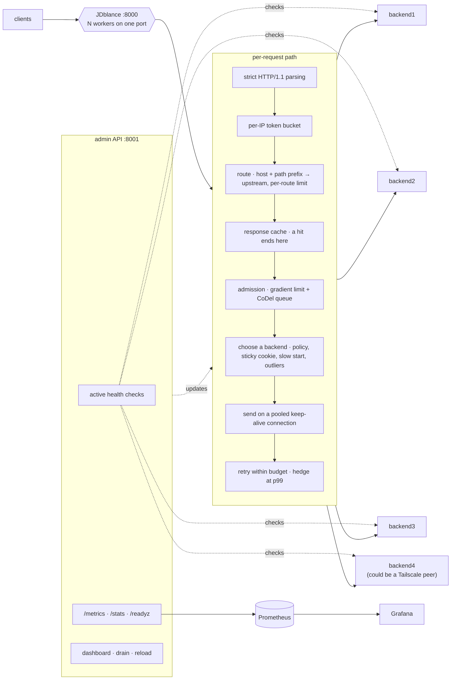

# JDblance: a dependency-free HTTP load balancer in C++20

JDblance is an HTTP/1.1 reverse proxy and load balancer written in **C++20**.
It needs **nothing but a C++ compiler and `make`**. Beyond spreading requests
across backends, it runs the feedback loops that keep a fleet standing under
stress: it learns its own concurrency limit, sheds load based on queueing
delay, ejects failing backends and statistical outliers, eases recovered
backends back in, races slow requests against a second backend, and caps
retries with a budget. It routes by host and path to separate backend pools,
keeps sessions sticky with consistent hashing or cookies, and caches responses
the origin marks as cacheable.

For comparison, the Docker stack also runs a tuned nginx on `:8080` in front of
the same backends.

```
$ make demo

phase                      rps   errors       p50       p99  distribution
------------------------------------------------------------------------------
1. baseline                300    0.00%      4.7ms      6.0ms  origin0:30%  origin1:34%  origin2:23%  origin3:13%
2. origin0 fails           300    0.00%      4.7ms      6.0ms  origin1:41%  origin2:32%  origin3:26%
3. origin1 crawls          300    0.00%      4.7ms      6.0ms  origin2:49%  origin3:51%
4. origin2 refuses         300    0.00%      4.6ms      6.0ms  origin3:100%
5. recovery                300    0.00%      4.7ms      6.1ms  origin0:20%  origin1:3%  origin2:28%  origin3:49%
6. origin3 flakes          300    0.00%      4.7ms      9.6ms  origin0:39%  origin1:22%  origin2:33%  origin3:6%
==============================================================================

worst client-visible error rate across all phases: 0.00% (during '1. baseline')
...while every origin, in turn, failed every request, crawled, refused connections outright, or quietly failed one request in four.
```

The demo breaks one origin per phase while a steady 300 requests per second
keep arriving, and every response counts toward the error column:

- **Phase 2:** origin0 fails every request, and its circuit breaker takes it out.
- **Phase 3:** origin1 slows down by 400 ms, and P2C and hedging move traffic
  off it with no help from health checks.
- **Phase 4:** origin2 refuses connections, and retries plus its breaker cover
  the gap.
- **Phase 5:** the faults are cleared. origin0 and origin2 come back through
  slow start, ramping up over 6 s instead of taking a full share at once.
  origin0 is the one that failed requests while its health check stayed
  green, so only the breaker could take it out and let it back in. origin1 is
  still at a few percent, because its latency estimate is still decaying.
- **Phase 6:** origin3 starts failing one request in four. That is below the
  breaker's 50% threshold, and retries hide every failure from clients.
  Outlier detection compares origin3 with its peers, ejects it, and its share
  drops to 6%.

---

## On this page

- [Feature overview](#feature-overview)
- [Edge cases handled](#edge-cases-handled)
- [How a request flows](#how-a-request-flows)
- [Getting started](#getting-started)
- [Design notes](#design-notes)
- [Performance](#performance)
- [Admin API and dashboard](#admin-api-and-dashboard)
- [Config file](#config-file)
- [Metrics, logs and alerts](#metrics-logs-and-alerts)
- [Remote backends over Tailscale](#remote-backends-over-tailscale)
- [Running the tests](#running-the-tests)
- [Known limitations](#known-limitations)

---

## Feature overview

| | |
|---|---|
| **HTTP** | HTTP/1.1 keep-alive to clients and backends, chunked bodies, `Expect: 100-continue`, WebSocket and other `Connection: Upgrade` tunnels with half-close, HTTP/1.0 clients, strict message framing |
| **Request routing** | host (exact or `*.example.com`) and path-prefix routes to named backend pools, each with its own policy; optional prefix stripping |
| **Balancing policies** | round robin · smooth weighted round robin · random · least connections · **P2C with peak EWMA** · bounded-load consistent hashing · **Maglev** · cookie-based sticky sessions |
| **Health** | active probes with rise/fall thresholds and jitter; passive circuit breakers with exponential backoff and half-open probing; **success-rate outlier detection**; **slow start** for backends that join or recover |
| **Overload protection** | adaptive concurrency limit (gradient algorithm), CoDel admission queue that switches to LIFO, per-IP token buckets, **per-route rate limits** keyed by client IP or by a header such as an API key, a connection cap |
| **Caching** | in-memory LRU cache for responses marked cacheable by `Cache-Control`, served without touching a backend or an admission slot |
| **Tail latency** | hedged requests timed from the live p99, pooled upstream connections, `TCP_NODELAY` on every socket |
| **Safety** | retry budget, buffered request bodies so retries are possible, idempotency-aware replay, panic mode, a parser built to resist request smuggling |
| **Operations** | live admin API and dashboard; drain, enable, disable and re-weight backends at runtime; reload on `SIGHUP`; graceful drain on `SIGTERM` |
| **Observability** | 35+ Prometheus metrics, per-request JSON access logs with request IDs, a ready-made Grafana dashboard, alert rules |
| **Multi-core** | one process per core sharing a port through `SO_REUSEPORT`, with a supervisor that restarts crashed workers |
| **Dependencies** | none: a C++20 compiler (tested with GCC 13) and `make`, on Linux |

---

## Edge cases handled

Load balancers rarely break inside a single component; they break where two
control loops meet. JDblance deals with the situations below deliberately, and
the test suite covers every one of them.

**Failure handling**

- **Ejected backends rejoin on their own.** Once a breaker's cooldown runs out,
  the endpoint is eligible for selection again with no health check required,
  and one successful request closes the breaker. A backend that serves 500s
  while `/health` still answers 200 is pulled out and readmitted purely on live
  traffic (row 5 of the demo).
- **Half-open probe slots are never lost.** A probe slot is used only by the
  endpoint that was actually picked. If a probe's request is abandoned and
  never reports back, the slot is released after one cooldown, so no breaker
  gets stuck half-open.
- **Unsafe replays can't happen.** Until a request has been written upstream,
  any method can be retried. After that point only idempotent methods are, so
  a POST that the origin might already have handled is never sent twice.
- **Bad clients don't count against backends.** A broken upload is recorded as
  a client error, which stops misbehaving clients from tripping the breaker of
  a healthy backend.
- **Unmeasured endpoints get tried.** While an endpoint has no latency sample
  and nothing in flight, its cost is zero, so P2C sends it a request instead
  of leaving it idle behind faster neighbours.
- **The loser of a hedge race is still measured.** When a slow primary is
  cancelled because its hedge answered first, the time it had already spent
  waiting is recorded as a lower bound on its latency. Otherwise the slow
  backend would look idle, keep getting picked, and set off hedges that eat
  into the retry budget meant for real failures.
- **Running out of local resources isn't blamed on backends.** Connect errors
  such as `EMFILE` and `ENOBUFS` produce a 503 without tripping any breaker,
  and at startup the soft `RLIMIT_NOFILE` is raised to the hard limit.
- **`/readyz` is honest.** Readiness reports failure in panic mode, while
  traffic is being spread over a fleet that mostly looks unhealthy.
- **Small fleets can still eject an outlier.** Each backend's success rate is
  compared with the mean and spread of its *peers*, not of a group that
  includes itself. Including it (Envoy's formula) drags the mean down and the
  spread up so much that, with fewer than five backends, even one failing
  every request never falls below `mean - 1.9 × stdev`.
- **The cache can't serve the wrong response.** Responses with `Vary`,
  `Set-Cookie`, `private`, `no-store` or `no-cache` are never stored, and
  requests with `Authorization`, `Range` or a client `no-cache` never read from
  it.
- Tunnels time out on inactivity rather than total lifetime, so long-running
  WebSockets stay up, and a half-close is passed through in either direction.
- Breaker windows roll forward correctly after long quiet periods, so the
  error-rate trip isn't delayed.
- HTTP/1.0 is supported on both sides: 1.0 clients receive de-chunked bodies,
  a 1.0 request without `Host` gets one added before forwarding, and a
  connection from a 1.0 origin that closes by default is never put back in the
  pool.
- **Slow start doesn't starve a neighbour.** When a warming endpoint's turn is
  declined, the replacement is chosen by a stateless P2C rather than by asking
  the policy again. Asking round robin again correlates its counter with the
  rejection, and in testing the endpoint next in the rotation got a third of
  the traffic of the others.
- **A sticky cookie never pins a client to a failure.** The cookie's backend is
  preferred only on the first attempt and only while it is usable; a retry, or
  a client whose backend has gone away, is balanced normally and re-pinned to
  wherever it lands.
- **Readiness covers every pool.** With several upstreams, `/readyz` fails if
  any of them has no usable endpoint or is in panic mode, since some of the
  routes would then fail.

**Hardening**

- An empty line before the request line is ignored, as RFC 9112 recommends.
- Header names have to be valid tokens; header values can't contain CR, NUL or
  other control characters; the request target has to be printable ASCII; a
  status line needs exactly three digits; `Content-Length` has to be plain
  ASCII digits.
- A request whose `Transfer-Encoding` is anything other than exactly `chunked`
  is rejected, because re-framing something like `gzip, chunked` would quietly
  lose the gzip. Codings on responses pass through untouched.
- `X-Request-ID` values and request targets are JSON-escaped before they reach
  logs or error bodies, and a client-supplied request ID is forwarded only if
  it contains safe characters.
- With `trust_forwarded_for` on, the connecting peer's address is appended to
  the forwarded chain.
- Endpoint names and hostnames are validated, since they end up in URLs,
  metric labels and the dashboard, and the `method` metric label has a bounded
  set of values.

**Operations**

- A reload applies every setting at once (endpoints, policy, retry budget, rate
  limits, concurrency, health checks, breakers) and keeps anything that was set
  on the command line.
- When a drain starts, idle keep-alive connections are closed right away, and
  any connection accepted during the drain gets one response with
  `Connection: close`.
- If a worker dies, the supervisor starts a replacement, no more than once per
  second for each slot.
- The config parser rejects unknown keys, values of the wrong type and
  duplicate keys, and checks ranges such as timeouts, probabilities and a prime
  Maglev table size.

---

## How a request flows



A worker is a single thread with a single event loop, built from C++20
coroutines on top of `epoll`. Because only that thread ever touches proxy
state, the request path needs no locks. DNS lookups are the one exception:
they run on short-lived threads and hand their results back through an
`eventfd`.

| File | What it contains |
|---|---|
| [`src/loop.hpp`](src/loop.hpp) | the event-loop runtime: `Task<T>` coroutines, epoll reactor, timers, sockets, buffered reads, asynchronous DNS |
| [`src/proxy.cpp`](src/proxy.cpp) | the request path: admission, backend choice, attempts, retries, hedging, body relay, tunnels |
| [`src/http1.cpp`](src/http1.cpp) | streaming HTTP/1.1 parser and serializer, and the message-framing rules |
| [`src/balancer.cpp`](src/balancer.cpp) | all seven routing policies |
| [`src/hashring.cpp`](src/hashring.cpp) | BLAKE2b, the Maglev lookup table and the bounded-load hash ring |
| [`src/endpoint.cpp`](src/endpoint.cpp) | state kept for each backend: breaker, latency EWMA, connection pool |
| [`src/limits.cpp`](src/limits.cpp) | token buckets, retry budget, gradient limiter, CoDel queue |
| [`src/upstream.cpp`](src/upstream.cpp) | one backend pool: selection, slow start, outlier detection, sticky preference |
| [`src/routing.cpp`](src/routing.cpp) | host and prefix matching, cacheability rules, the LRU response cache |
| [`src/health.cpp`](src/health.cpp) | active health checks |
| [`src/server.cpp`](src/server.cpp) | worker processes, supervisor, signal handling, graceful drain, reload, command line |
| [`src/admin.cpp`](src/admin.cpp) | admin API and dashboard |
| [`src/metrics.cpp`](src/metrics.cpp) | Prometheus metric registry |
| [`src/config.cpp`](src/config.cpp), [`src/json.cpp`](src/json.cpp) | loading and validating the config; JSON |
| [`src/origin.cpp`](src/origin.cpp) | a test backend with fault injection, also used as the backend in Docker |
| [`cmd/loadgen.cpp`](cmd/loadgen.cpp) | open-loop load generator that corrects for coordinated omission |
| [`cmd/demo.cpp`](cmd/demo.cpp) | the scripted fault-injection run shown at the top |
| [`cmd/alertbot.cpp`](cmd/alertbot.cpp) | alerting sidecar |

---

## Getting started

You need Linux (WSL works, or use Docker on anything) plus `g++` 13 or newer
and `make`:

```bash
make            # build the five binaries into build/
make demo       # origins, balancer and fault script together in one process
make test       # 127 unit and end-to-end tests, then the process smoke test
```

To run it locally as separate processes:

```bash
make run        # origins on 9001-9004, balancer on :8000, dashboard on :8001
make bench      # 2000 rps open-loop load test
```

Or bring up the full stack with Docker:

```bash
docker compose up --build -d
```

| Service | Address |
|---|---|
| Load balancer | <http://localhost:8000> |
| Admin API and dashboard | <http://localhost:8001> |
| Grafana (dashboard already loaded) | <http://localhost:3001> |
| Prometheus | <http://localhost:9091> |
| nginx, for comparison | <http://localhost:8080> |
| Origins, directly | <http://localhost:5001> … `5004` |

Inject a fault and watch traffic move away from it:

```bash
curl -X POST localhost:5001/chaos -H 'content-type: application/json' -d '{"fail_rate":1.0}'
curl -X POST localhost:5002/chaos -H 'content-type: application/json' -d '{"latency_ms":400}'
curl localhost:8001/stats
```

The same settings also work as query parameters (`POST /chaos?stall=1`,
`?healthy=0`, `?reset=1`), and opening an origin in a browser shows a small
page with buttons for them.

---

## Design notes

### Picking a backend: P2C with peak EWMA

Sending every request to whichever backend looks least loaded sounds right but
backfires: every worker sees the same numbers at the same moment, and they all
pile onto the same backend. Random choice avoids that. JDblance picks two
backends at random and uses the cheaper of the two. By Mitzenmacher's
analysis, the busiest backend's load drops from `O(log n / log log n)` to
`O(log log n)`, and because two workers seldom sample the same pair, there's no
stampede.

The comparison uses a cost rather than a plain counter
([`src/endpoint.cpp`](src/endpoint.cpp)):

```
cost = latency_ewma * (in_flight + 1) / weight
```

The latency EWMA decays over wall-clock time, so a backend that has been idle
gradually looks cheap again, while one that was just handed 50 requests looks
expensive until it works through them. Multiplying by the in-flight count is
what keeps the score from swinging back and forth. A backend that has never
been measured costs nothing while idle, so it always gets tried.

In the demo above, origin1 served 41% of responses in phase 2. Once it was
slowed by 400 ms in phase 3, it served none, with no help from health checks.

### Sticky routing with Maglev and bounded-load hashing

There are two hashing schemes, because each one breaks down in a different way
([`src/hashring.cpp`](src/hashring.cpp)):

- **Maglev** (Google, NSDI '16) fills a 65537-slot lookup table using a
  permutation for each backend. A lookup costs one modulo and one array read,
  so it's `O(1)` with no binary search. Taking 1 of N backends away remaps
  about 1/N of the keys, compared with about (N-1)/N for a plain `hash % n`.
  The tests check that fewer than 30% of keys move when one of eight backends
  leaves, and that the slot counts are within 2% of each other.
- **Consistent hashing with bounded loads** (Mirrokni et al., 2016) keeps
  walking the ring past any backend whose in-flight count already exceeds
  `c × average`. Without the bound, a single popular key would overload
  whichever backend owns it; with it, the hot key spills over while every other
  key stays where it is.

Both use BLAKE2b, implemented from RFC 7693 with a salted 8-byte digest, and
the tests pin its output against reference vectors. A hash seeded randomly in
each process would give every worker its own ring.

### Discovering the concurrency limit

A fixed concurrency limit stops being right as soon as the backend moves to
different hardware. Little's Law ties the quantities together
(`concurrency = throughput × latency`), so JDblance measures its way to the
limit instead ([`src/limits.cpp`](src/limits.cpp)):

```
gradient  = clamp(1.5 × rtt_noload / rtt_sample, 0.5, 1.0)
new_limit = limit * gradient + sqrt(limit)
limit     = (1 - α) * limit + α * new_limit
```

`rtt_noload` is a long-term minimum latency that gets re-measured now and
then, so a real speed-up is eventually noticed. As latency rises, the gradient
drops below 1 and the limit comes down before the backend is saturated. The
`sqrt(limit)` term allows a small standing queue; without it the limit could
never grow. An upstream timeout cuts the limit straight away instead of waiting
for the next window. The latency sample starts at admission, not at arrival:
if the limiter saw its own queueing delay, it would shrink the limit, which
adds queueing, which shrinks it again, until it sits at the floor.

### Shedding load by queue delay

A queue with a fixed length makes a poor admission controller, because the
right length depends on service time, and service time moves. CoDel looks at
how long requests wait instead. If the shortest wait stays above `target`
(5 ms) for a whole `interval` (100 ms), the queue isn't draining, and requests
start being dropped. The gap between drops shrinks with `1/√count`, so
sustained overload is shed more and more firmly rather than in bursts.

When overloaded, the queue also switches from **FIFO to LIFO**. It sounds
backwards but is right: when not everyone can be served, the newest request
belongs to the client most likely to still be waiting. Serving oldest-first
under overload mostly produces responses for clients who have already given up.

### Ejecting bad backends, and when to stop

A breaker trips on either of two conditions, because each catches something
different. A rolling-window *error rate* spots a backend that is slowly
getting worse, while a streak of *consecutive* failures spots one that has just
gone down, without waiting for the window to fill up. Every consecutive trip doubles the
cooldown, up to a maximum, and the half-open state lets a limited number of
probe requests through. When the cooldown ends, the endpoint is selectable
again without outside help, and a successful probe closes the breaker.

**Panic mode**: when fewer than `panic_threshold` (50% by default) of the
endpoints are healthy, JDblance ignores health state and spreads traffic
across all of them. Envoy behaves the same way, for this reason: if most of the
fleet appears unhealthy, the health check itself is the likeliest thing to be
wrong, and pushing all traffic onto the few backends that still pass would
cause the outage. `/readyz` keeps reporting not-ready during panic mode, so an
orchestrator can see it.

### Budgeted retries

Retries add load exactly when the fleet can least take it; a blanket "try
three times" turns a partial outage into a full one. JDblance therefore spends
retries from a **budget**: a capped share of live traffic (10% by default,
plus a floor of 3 per second). If the fleet really is down, retries dry up on
their own.

A retry needs the body to still be available, so request bodies of known
length up to `retry.buffer_bytes` (64 KiB) are buffered, which lets a POST be
resent. Larger bodies and chunked bodies are streamed and never retried. Until
a request has been written upstream it can be retried after any failure; once
written, only idempotent requests are, so a POST the origin may have processed
is never repeated. After the first response byte reaches the client, the
request is final. The delay between attempts grows exponentially and is
randomised with **full jitter**; without that randomness, every retrying client
would wake up at the same moment.

### Racing slow requests

For idempotent requests without a body, if the first attempt hasn't produced
response headers by the cluster's current p99, JDblance sends a copy to another
backend (picked at that moment, not up front), keeps whichever answer arrives
first and cancels the other. It's insurance for the tail: it costs at most one
extra request, only kicks in for the slowest requests, and spends from the same
retry budget, so a cluster that is slow everywhere can't hedge itself into
collapse. The cancelled attempt still reports how long it had waited, so the
balancer learns that the backend is slow rather than thinking it idle.

### Strict parsing against request smuggling

Anywhere the proxy and the origin disagree about where a message ends is a
request-smuggling hole. The parser ([`src/http1.cpp`](src/http1.cpp)) treats
every ambiguity as an error instead of guessing:

- both `Content-Length` and `Transfer-Encoding` → `400`, which shuts out the
  whole CL.TE / TE.CL family instead of preferring one header over the other
- repeated, conflicting or malformed `Content-Length` → `400`
- a request `Transfer-Encoding` that isn't exactly `chunked` → `400`
- obsolete line folding, whitespace before a header's colon, header names that
  aren't tokens, control characters in values or in the request target → `400`
- an HTTP/1.1 request with no `Host`, or more than one → `400`
- chunk sizes are parsed strictly (hex digits only, at most 16 of them, with a
  hard size cap), and chunks are **re-encoded** on the way out, so extensions
  and unusual trailer formatting never pass through
- hop-by-hop headers, **plus every header listed in `Connection:`**, are
  removed before forwarding, so a client can't slip proxy-level directives to
  the backend

Apart from the retry buffer, bodies are streamed rather than held in memory:
relaying a 4 GiB upload uses a single 64 KiB buffer, and each write finishes
before the next read begins, so backpressure reaches all the way back to the
sender. When a small response arrives in one piece together with its headers,
it goes to the client in one write.

### Warming up backends that join or recover

A backend that has just started, or just come back from an outage, often
answers slowly at first: cold caches, an unwarmed JIT, empty connection pools.
Giving it a full share of traffic straight away can knock it over again. With
`slow_start.window` set, an endpoint added by a reload, or one that becomes
available again after a failed health check, a breaker trip or being disabled,
gets a share of traffic that grows linearly from `min_weight` (10% by default)
to 100% over the window ([`src/upstream.cpp`](src/upstream.cpp)).

It works with every policy without each one knowing about it. The policy picks
as usual; if it picked a warming endpoint, the pick is kept with probability
equal to the current share, and otherwise a stateless P2C picks among the
rest. Hash policies are exempt, because diverting a key would break the
affinity that is the reason for choosing them. Backends present at startup
don't warm up, since nothing has seen them yet.

### Ejecting outliers by comparing with peers

A breaker trips on a *fixed* threshold, such as 50% errors. A backend failing
20% of requests while its peers fail none is clearly broken, but it never
reaches that threshold. Outlier detection catches it by comparison instead.
Every `interval` (10 s), each endpoint that served at least `min_requests` in
it is compared with the others that did. It is ejected when its success rate
is below their mean by more than `stdev_factor` (1.9) standard deviations
*and* by more than `min_gap` (10 points). The second condition stops a backend
at 98% from being ejected next to peers at exactly 100%, where the spread is
zero.

The comparison is leave-one-out: the mean and spread come from the *other*
endpoints. Envoy's formula includes the endpoint being judged, and in a small
fleet that hides it. With four backends where one fails every request, the
mean is 0.75 and the spread 0.43, so the threshold of 0.75 − 1.9 × 0.43 is
below zero and nothing is ejected. Leave-one-out compares it with peers at 100%
and ejects it.

An ejection opens the endpoint's breaker for `base_ejection` × (times ejected
in a row), up to 10×, and the breaker's half-open probe brings it back. At
most `max_ejection_percent` of an upstream can be ejected at once, though one
always can be. The check runs lazily from the selection path once per
interval, so it needs no timer, and an upstream with no traffic has nothing to
judge anyway.

### Routing to separate pools

The top-level `endpoints` form the upstream called `default`. `upstreams` adds
more named pools, each with its own policy, hash key and sticky-cookie
settings, and `routes` decides which pool a request goes to
([`src/routing.cpp`](src/routing.cpp)):

```jsonc
"upstreams": [{"name": "api", "policy": "least_conn",
               "endpoints": [{"name": "api1", "address": "10.0.0.5:8080"}]}],
"routes": [
  {"name": "api", "prefix": "/api", "upstream": "api", "strip_prefix": true,
   "rate_limit": {"rate": 50, "burst": 100, "key": "header:X-Api-Key"}},
  {"name": "shop", "host": "*.shop.example", "upstream": "api"}
]
```

Routes are tried in order and the first match wins. `host` is empty (any
host), an exact name, or `*.example.com` for any subdomain; the port in the
`Host` header is ignored. `prefix` matches whole path segments, so `/api`
matches `/api` and `/api/users` but not `/apix`. A request that matches no
route goes to `default`, or gets a 404 if there is no default pool.
`strip_prefix` removes the prefix before forwarding, so `/api/users?id=7`
reaches the backend as `/users?id=7`.

A route's `rate_limit` is a token bucket per key, separate from the global
per-IP limit. The key is the client IP, or the value of a header (an API key,
say), falling back to the client IP when the header is missing.

### Sticky sessions with cookies

Hash policies keep a *key* on the same backend, but the key has to exist in
every request. Setting `sticky.cookie` on an upstream makes the balancer create
one instead. The first response carries a `Set-Cookie` naming the backend
that served it, as a 16-character hash rather than its real name, marked
`HttpOnly` and `SameSite=Lax`, with an optional `Max-Age`. Later requests with
the cookie go to that backend while it is usable. If it isn't, because it's
unhealthy, disabled, ejected or draining, the request is balanced normally and
the client is pointed at its new backend. Retries ignore the cookie, because a
retry means that backend has just failed.

### Caching responses

With `cache.enabled`, a GET response is stored when the origin explicitly says
it may be (`Cache-Control: max-age` or `s-maxage`, minus any `Age` it already
has) and it carries nothing that makes sharing it unsafe. The rules are
conservative. A response is never stored if it has `Vary`, `Set-Cookie`,
`private`, `no-store` or `no-cache`, if its status isn't one of 200, 203, 204,
300, 301, 308, 404 or 410, or if its size isn't known up front. A request
never reads from the cache if it carries `Authorization` or `Range`, or asks
for `no-cache` / `no-store`.

A hit is answered before admission, so it costs no concurrency slot and never
touches a backend. It gets an `Age` header and, with debug headers on,
`X-Cache: HIT`; HEAD requests are served from the stored GET. The cache is an
LRU bounded by bytes (64 MiB by default, 1 MiB per object), one per worker. A
route can opt out with `"cache": false`.

### Using every core with SO_REUSEPORT

One event loop can only use one core. With `listen.workers > 1`, JDblance
forks N processes that all `bind()` the same port with `SO_REUSEPORT`, and the
kernel assigns each connection to one of them by hashing its 4-tuple.
Connections are distributed inside the kernel, with no shared lock, no
thundering herd and no hand-off through a parent process; nginx and Envoy use
the same technique on Linux. The supervisor passes signals on and replaces any
worker that exits.

Every worker serves its own admin API at `admin.port + worker_index`, so
Prometheus scrapes each worker separately instead of whichever one the kernel
happened to route the scrape to.

```bash
JDBLANCE_WORKERS=4 docker compose up -d      # admin APIs on 8001-8004
```

---

## Performance

Tools such as `ab` and `wrk` run as a **closed loop** by default: each
connection waits for a response before sending its next request. So when the
server freezes, the tool pauses with it, and the freeze leaves no trace in the
results. That effect is known as *coordinated omission*: it's how a server that
hung for two full seconds can still be credited with a 5 ms p99.

[`cmd/loadgen.cpp`](cmd/loadgen.cpp) avoids it with the approach Gil Tene
describes. Request times come from a **Poisson process at a fixed rate**, no
matter how many responses have come back, and each latency is measured from
when the request was **meant** to be sent. The report shows the corrected and
uncorrected figures side by side so the gap is visible, and `--max-error-rate`
makes it usable as a CI check.

### Results

Each run is 5 seconds of open-loop load against four `jdblance-origin`
backends that take 1 ms per request, with hedging on and access logging off.
The load generator, proxy and origins all ran on the same 16-vCPU WSL2 VM
(kernel 5.15), with the Windows host idle and on mains power. Every row is the
median of three runs, and latency is corrected for coordinated omission:

| target rate | workers | actual rate | p50 | p99 | p99.9 | errors |
|---|---|---|---|---|---|---|
| 2,000 rps | 1 | 1,989 rps | 1.47 ms | 1.8 ms | 2.0 ms | 0 |
| 5,000 rps | 1 | 4,980 rps | 1.27 ms | 1.5 ms | 1.8 ms | 0 |
| 10,000 rps | 1 | 10,009 rps | 1.22 ms | 1.4 ms | 2.3 ms | 0 |
| 20,000 rps | 1 | 20,014 rps | 1.23 ms | 2.0 ms | 3.3 ms | 0 |
| 10,000 rps | 4 | 9,997 rps | 1.22 ms | 1.4 ms | 1.6 ms | 0 |
| 20,000 rps | 4 | 20,038 rps | 1.28 ms | 1.6 ms | 2.7 ms | 0 |
| 40,000 rps | 4 | 39,968 rps | 1.45 ms | 2.1 ms | 2.9 ms | 0 |
| 60,000 rps | 4 | 59,881 rps | 1.54 ms | 3.3 ms | 10.5 ms | 0 |

None of these runs returned a single error or 503, and the three repeats of
each row agreed closely: the largest single p99 in the table's runs was 4.3 ms.

A single worker saturates at about **30k rps** on this machine. Offered 30k,
it kept up (p99 under 4 ms in two of three runs). Offered 40k and 60k, it
delivered between 29.5k and 30.4k (median 30.0k over six runs), with latency
climbing into seconds as requests queued and six requests shed with 503.
Turning the access log on lowers that ceiling by about 6% (median 28.3k over
the same six offered loads). Four workers kept up with 60k rps, which is as
far as these runs go: the load generator is single-threaded and shares the
16 vCPUs, so a higher rate would measure it as much as the proxy.

These numbers depend heavily on the machine being otherwise idle. With a game
and a browser running on the same Windows host, the same benchmark gave p99s
of up to 180 ms at 10–20k rps and a single-worker ceiling of 20–23k. To
reproduce the table, close other applications, keep the machine plugged in,
and run each row more than once.

Because wall-clock throughput depends on whatever else the machine is doing,
the cost per request is also measured deterministically: callgrind counts
**about 64,000 CPU instructions per proxied request** (keep-alive client and
upstream, hedging on, access log off). That covers parsing the request and
response heads, routing, backend selection, building the upstream request,
relaying the response, and metrics. Removing per-request allocations
(lower-cased header copies, `Connection` token vectors, metric label vectors
for gauges nobody reads between scrapes) took it from 73,600 to 64,400, a
12.6% cut. Treat these numbers as relative, measured on one machine.
`make compare` sends identical open-loop load to JDblance and to the nginx
comparison in the Docker stack, so you can measure both on your own hardware.

---

## Admin API and dashboard

Port 8001 serves a live dashboard that needs nothing external: a table of
endpoints, breaker states, in-flight bars, a throughput sparkline and drain
buttons, with no CDN assets and no JavaScript build.

```
GET  /                          the dashboard
GET  /metrics                   metrics in Prometheus format
GET  /healthz                   liveness check
GET  /readyz                    readiness: 503 while draining or when no upstream can serve
GET  /stats                     the whole cluster state, as JSON
GET  /config                    the configuration in effect
POST /reload                    reload the config file
POST /drain                     drain this worker, for rolling deploys
POST /endpoints/<name>/drain    send no new requests; let in-flight ones finish
POST /endpoints/<name>/enable
POST /endpoints/<name>/disable
POST /endpoints/<name>/weight?value=N
POST /endpoints/<name>/breaker/open|close
```

The admin API has its own port on purpose: by the time you need `/drain`, the
traffic port is usually the one in trouble.

Readiness is designed to fail whenever no upstream can be used, panic mode
included, so that an orchestrator takes this instance out of *its* rotation
instead of sending traffic to a proxy that can only return errors.

```bash
curl -X POST localhost:8001/endpoints/backend1/drain   # take a backend out gracefully
docker compose kill -s HUP jdblance                    # reload the config in place
docker compose stop jdblance                           # drain, then exit
```

---

## Config file

Everything lives in one [`lb.json`](lb.json): JSON that allows `//` and `#`
comments and `${ENV:-default}` substitution. Every key has a default that is
safe for production, so the smallest valid config is just a list of endpoints.
An unknown key, a wrong type or an out-of-range value is an error that names
the key, and the check runs before any socket is bound:

```bash
build/jdblance --check -c lb.json
```

```jsonc
{
  "listen": {"host": "0.0.0.0", "port": 8000, "workers": 1},
  "policy": "p2c_ewma",
  "endpoints": [
    {"name": "backend1", "address": "backend1:5000", "weight": 1}
  ],
  "hedge":  {"enabled": true, "quantile": 0.99},
  "retry":  {"max_attempts": 3, "budget_ratio": 0.1},
  "limits": {"concurrency": {"enabled": true, "codel_target": 0.005}},
  "panic_threshold": 0.5
}
```

Command-line flags let you experiment without editing the file, and they still
apply after a reload:

```bash
build/jdblance -c lb.json --policy maglev --workers 4 \
  --endpoint a=10.0.0.1:8080 --endpoint b=10.0.0.2:8080:3 --endpoint c=[::1]:8080
```

Sending `SIGHUP`, or calling `POST /reload`, makes JDblance load the file
again. You can add, remove or re-weight
endpoints, switch the policy, and change any limit, budget, timeout, breaker or
health setting **without dropping a connection**. Endpoints present in both the
old and the new config keep their live state (breaker, EWMA, pooled
connections). If the new file doesn't validate, it is rejected and the current
config stays in force. Changing the listen or admin address needs a restart.

Hostnames are resolved off the event loop, then again every few seconds and
after any failed connect, so a backend container that comes back with a
different IP is picked up.

---

## Metrics, logs and alerts

`/metrics` exposes 35+ metrics. The request latency histogram is also where
the p99 used for hedging comes from:

```
jdblance_requests_total{method,status,endpoint}
jdblance_request_duration_seconds_bucket{endpoint,le}
jdblance_upstream_duration_seconds_bucket{endpoint,le}
jdblance_endpoint_up{endpoint}                jdblance_endpoint_breaker_state{endpoint}
jdblance_endpoint_ewma_seconds{endpoint}      jdblance_endpoint_in_flight{endpoint}
jdblance_concurrency_limit                    jdblance_admission_queue_depth
jdblance_admission_sojourn_seconds_bucket     jdblance_shed_total{reason}
jdblance_retries_total{reason}                jdblance_retry_budget_denied_total
jdblance_hedges_total                         jdblance_hedge_wins_total
jdblance_pool_reused_total{endpoint}          jdblance_pool_created_total{endpoint}
jdblance_route_requests_total{route}          jdblance_outlier_ejections_total{endpoint}
jdblance_cache_total{result}                  jdblance_cache_bytes
...
```

Every request produces one JSON log line, including the request ID that was
sent upstream in `X-Request-ID`:

```json
{"ts":1786378573.912345,"ip":"10.0.0.7","method":"GET","target":"/","status":200,
 "ms":3.510,"upstream":"backend2","attempts":1,"hedged":false,"rid":"a1b2c3d4e5f60718","w":0}
```

Grafana loads its 20-panel dashboard from [`grafana/`](grafana/) on startup,
so there is nothing to import by hand. [`prometheus/rules.yml`](prometheus/rules.yml)
has ten alert rules based on what users experience rather than on internal
causes: one backend being down is a *warning*, since the balancer has already
routed around it, while more than 5% of client responses failing is a *page*.

[`cmd/alertbot.cpp`](cmd/alertbot.cpp) is a sidecar that takes its list of
backends from the balancer's own `/stats` instead of a separate config, so it
always watches exactly the set that traffic goes to. It raises alerts for
breaker trips, panic mode and sustained shedding, none of which a simple
"does it return 200" probe would notice. Delivery to WhatsApp through Twilio is
optional and goes via `curl`, with the credentials passed on curl's stdin so
they never show up in the process list; with no credentials configured, alerts
are printed to stdout.

---

## Remote backends over Tailscale

Backends can live on other machines and other networks. Tailscale gives every
device a fixed `100.x` address on a WireGuard network, so a laptop, a
Raspberry Pi and a cloud VM can all sit behind one JDblance instance without
opening ports or exposing anything publicly.

1. Set up Tailscale on each host and join them all to a **single tailnet**.
2. Find each backend's address with `tailscale ip -4`.
3. Start an origin on it: `jdblance-origin --port 5005 --name laptop`, or with
   Docker: `docker run -d -p 5005:5000 --entrypoint jdblance-origin <image> --port 5000`.
4. List it in [`lb.json`](lb.json), then reload instead of restarting:

```jsonc
{"name": "laptop", "address": "100.119.221.6:5005", "weight": 1}
```

```bash
curl -X POST localhost:8001/reload
```

For Prometheus to scrape it as well, add the same address to
[`prometheus/prometheus.yml`](prometheus/prometheus.yml). Weights matter more
for remote backends: either give them a lower weight, or use `p2c_ewma`, which
measures the extra network latency by itself and moves traffic to match. That
is exactly what a latency-based cost is for.

---

## Running the tests

```bash
make test        # 127 unit and end-to-end tests, then tests/smoke.sh
make asan        # the same tests built with AddressSanitizer and UndefinedBehaviorSanitizer
```

- **`tests/unit_tests.cpp`** covers the HTTP parser, with most cases aimed at
  smuggling; the *property* each routing policy is meant to guarantee (smooth
  WRR never bursts, P2C steers away from a slow backend, under 25% of keys move
  on the ring, Maglev slots within 2%, bounded loads spill hot keys, BLAKE2b
  matches reference vectors); the arithmetic inside breakers, budgets, the
  limiter and CoDel; route matching and prefix stripping; which requests and
  responses the cache accepts, and its LRU; the slow-start ramp and the share
  it produces; outlier ejection, its gap, volume and cap rules, and longer
  ejections for repeat offenders; config validation; JSON; and metrics output.
- **`tests/e2e_tests.cpp`** runs real sockets, origins and proxy inside one
  event loop: keep-alive reuse, chunked upload re-framing, `100-continue`,
  retries past dead and refusing backends, breaker ejection *and* recovery,
  POSTs not replayed once sent, the 429/413/503 paths, sticky sessions, the
  admin API, panic mode, drain, hedging, health checks, live reconfiguration,
  WebSocket tunnels with half-close and HTTP/1.0 clients, path and wildcard
  host routing, 404s with no default pool, cookie pinning and re-pinning,
  cache hits without the backend (and five kinds of response it must refuse),
  per-key route limits, an outlier ejected while its breaker stays closed, and
  slow start after a reload, with the protocol corner cases driven by scripted
  raw upstreams.
- **`tests/smoke.sh`** runs the compiled binaries as real processes: the CLI,
  `SIGHUP` reload (including a broken config and command-line overrides), how
  long a `SIGTERM` drain takes, several workers sharing one port, restart after
  `kill -9`, the load generator and the alert bot.

CI runs all of it both normally and with sanitizers, along with the
fault-injection demo, a 3000 rps soak test that fails above 0.1% errors, and a
Docker Compose smoke test.

---

## Known limitations

Every project has gaps; these are JDblance's:

- **Linux only.** The runtime relies on `epoll`, `signalfd`, `eventfd` and
  `SO_REUSEPORT`. On macOS or Windows, run the Docker image.
- **HTTP/1.1 only.** HTTP/2 and HTTP/3 aren't supported; multiplexed h2
  connections to backends would need a rather different connection pool.
- **No TLS termination.** Run it behind something that terminates TLS, or on a
  network that already encrypts traffic, such as Tailscale/WireGuard.
- **Metrics are per worker.** With several workers, Prometheus scrapes each
  port and adds them up; counters aren't merged in shared memory.
- **A deliberately simple cache.** No `Vary` support (such responses aren't
  stored), no revalidation with `ETag` / `If-Modified-Since`, no `Expires`
  header, and each worker has its own cache.
- **Routing is host and prefix only.** No regular expressions, header or
  method matching, or rewriting beyond stripping the prefix.
- **No service discovery.** Endpoints come from the config file and the admin
  API. Adding Consul or Kubernetes would mean a watcher that calls
  `Cluster::apply_config`, the same path `SIGHUP` uses.
- **Compiler.** Only GCC 13 has been tested. GCC 13 crashes with an internal
  compiler error on a braced initializer list inside a `co_await`ed call, so
  the code gives those temporaries names; other compilers haven't been tried.

---

Licensed under MIT; see [LICENSE](LICENSE).
